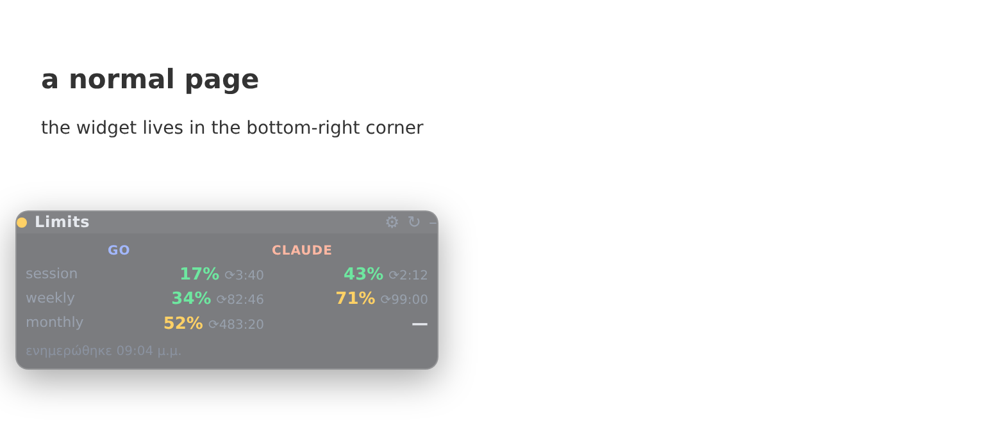
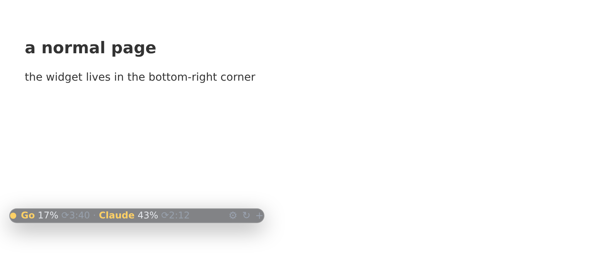
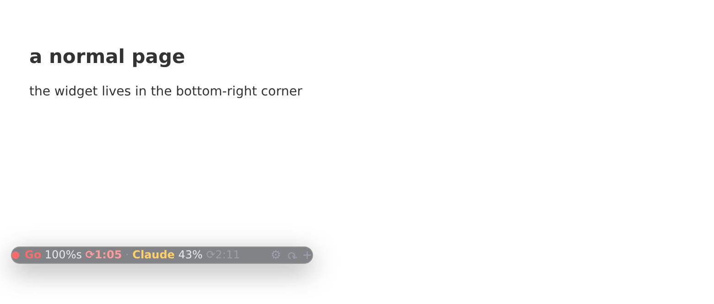

# QuickLimits — Claude & OpenCode Go usage userscript

How much of your subscription limits you have already burned — **OpenCode Go** (left column)
and **Claude** (right column) — each for its **session / weekly / monthly** window, in a
transparent panel in the bottom-left corner of every page.



Folded, it is a single bar with **both** subscriptions, the session percentage and a live
`H:MM` countdown to the reset:



Nothing about you lives in this repo and nothing is sent anywhere except to `claude.ai` and
`opencode.ai`: the script asks the two services with the cookies your browser already has.

## Install

1. Install [Tampermonkey](https://www.tampermonkey.net/) (Firefox, Chrome, Edge, …).
2. Click **[Install quick-limits.user.js](https://raw.githubusercontent.com/tasosxynos/quick-limits-userscript/main/quick-limits.user.js)**
   — Tampermonkey shows its install page, press *Install*.
3. Open the panel and set your OpenCode **workspace id** (⚙) — see below.

Future versions install themselves: `@updateURL` / `@downloadURL` point at this repo.

## What it does

| | |
|---|---|
| Panel | fixed bottom-**left** on every http(s) page (the companion [QuickVAT](https://github.com/tasosxynos/greek-vat-userscript) panel lives bottom-right, so they never overlap); draggable by its header, double-click the bar to re-dock |
| Columns | **OpenCode Go** left, **Claude** right; rows are session / weekly / monthly |
| Folded bar | both subscriptions at once — the **session** percentage plus `⟳H:MM` to its reset; the colour reports the hottest window of that service (green <50, amber ≥50, orange ≥80, red 100) |
| Exhausted | that cell switches to `100%s` / `100%w` / `100%m` — which window died — with a red countdown to when it frees |
| Transparency | translucent (55%) with backdrop blur, solidifying on hover — it never hides what is underneath |
| Refresh | automatically every 60 s while the tab is visible, `↻` on demand; the header tooltip lists all six windows with their countdowns |
| Keyboard | `Alt+W` fold / unfold |



## The OpenCode workspace id (⚙)

The OpenCode console is a client-side SPA, so its numbers come from
`GET https://opencode.ai/console/api/go/status` — authenticated with your console cookies and
**requiring an `x-org-id` header**. That is why the script needs your workspace id: the
`wrk_…` / `org_…` part of the console URL, `https://opencode.ai/console/<id>/…`.

- paste it into **⚙ → workspace id**, or
- just open the console once — the script captures it automatically.

Claude needs nothing: the organisation with the `chat` capability is discovered from
`claude.ai/api/organizations`.

## How the numbers are read

| Service | Endpoint | Windows |
|---|---|---|
| Claude | `claude.ai/api/organizations/<org>/usage` | `five_hour` (session), `seven_day` (weekly), `extra_usage` (monthly — only shows when enabled) |
| OpenCode Go | `opencode.ai/console/api/go/status` | `access.meters.fiveHour` / `.week` / `.month` — micro-cents: `round(used/limit*100)`, forced to 100 when `used ≥ limit` |

Countdowns are plain `H:MM` to the reset of the window (hours pass 24 on weekly/monthly).
Both endpoints are private and undocumented: if a shape ever changes, the cell shows `—` and
the note names the service and the HTTP status rather than inventing a number.

## Tests

```sh
node tests/limits_test.mjs      # pure parsers / formatters / bar logic — no browser needed
```

## License

MIT — see [LICENSE](LICENSE).
